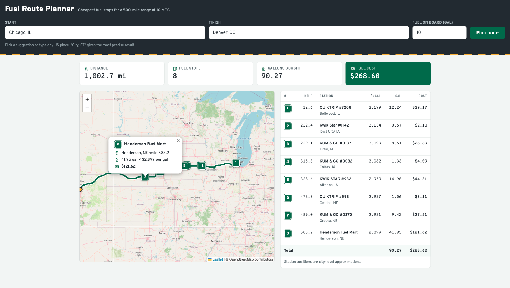
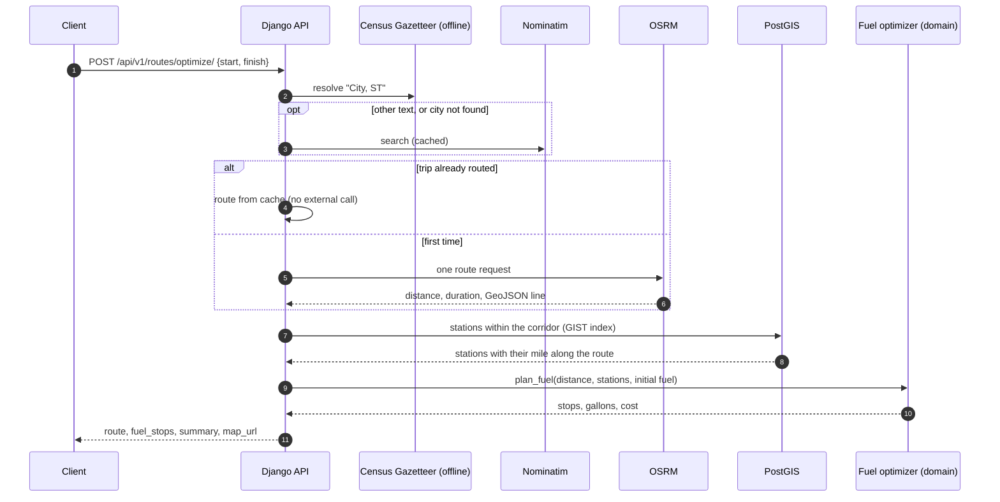

# Fuel Route Optimizer

A Django REST API that takes a start and finish anywhere in the USA and returns the driving route, the cheapest places to refuel along it (500-mile range, 10 MPG) and the total fuel cost, plus a map of the trip.

```
New York, NY → Los Angeles, CA: 2,810 mi · 19 stops · 281 gal · $857.34 · 1 routing call
```



*The demo page at `/map/` is a plain client of `POST /api/v1/routes/optimize/`: it draws the returned route, stops and costs.*

## Quick start

Requires Docker.

```bash
docker compose up --build -d                                         # API + PostGIS, runs migrations
docker compose run --rm web python manage.py import_stations         # load the fuel price CSV (~30 s, offline)
curl -X POST http://localhost:8000/api/v1/routes/optimize/ \
  -H 'Content-Type: application/json' \
  -d '{"start": "Chicago, IL", "finish": "Denver, CO"}'
```

Then open:

| URL | What |
|-----|------|
| `http://localhost:8000/api/docs/` | Swagger UI: every field and error code, with "Try it out" |
| `http://localhost:8000/map/` | Demo page: type a start and finish and see the plan on a map (every response's `map_url` opens it) |
| `http://localhost:8000/api/schema/` | OpenAPI 3 schema, importable into Postman |

Optional: put any variable from [Configuration](#configuration) in a `.env` file. Without it, local development defaults apply.

## API at a glance

`POST /api/v1/routes/optimize/`

| Field | Required | Notes |
|-------|----------|-------|
| `start`, `finish` | yes | `"City, ST"` resolves offline; any other text (address, landmark) uses Nominatim |
| `initial_fuel_gallons` | no | 0–50, default 0 (see assumptions) |

The response has `route` (distance, duration, GeoJSON line), `fuel_stops` (station, mile, price, gallons, cost), `summary` (`total_fuel_cost` and totals) and `map_url`.

Use `"City, ST"` (e.g. `"Chicago, IL"`) for the most precise and fastest result: it resolves offline. Other text goes to Nominatim, which may pick a different point in the same city, so results can differ slightly.

The API returns JSON only. `/map/` is a minimal demo client outside the API: a static page that calls `POST /api/v1/routes/optimize/` and draws the result with Leaflet, the same way any frontend would.

Real results from the supplied data:

| Trip | Distance | Stops | Gallons bought | Fuel cost |
|------|----------|-------|----------------|-----------|
| Dallas, TX → Houston, TX | 238 mi | 2 | 23.8 | $65.82 |
| Chicago, IL → Denver, CO | 1,003 mi | 9 | 100.3 | $300.84 |
| Chicago → Denver, departing with 25 gal | 1,003 mi | 6 | 75.3 | $220.87 |
| New York, NY → Los Angeles, CA | 2,810 mi | 19 | 281.1 | $857.34 |

Errors always return `{"error": "<code>", "detail": "..."}`: `invalid_request` (400), `location_not_found` (404), `route_not_found` / `no_station_near_origin` / `gap_exceeds_range` (422), `external_service_error` (502). Details in [`docs/api-contract.md`](docs/api-contract.md) and Swagger.

## Requirements coverage

Each requirement from [`docs/assignment.md`](docs/assignment.md), where it is met and the test that proves it.

| Requirement | Where | Proven by |
|-------------|-------|-----------|
| Start and finish within the USA | `CityStateResolver`: offline Gazetteer, Nominatim fallback restricted to the US | `test_city_state_is_resolved_offline_without_the_fallback`, `test_nominatim_returns_the_first_us_match_and_caches_it` |
| Return a map of the route | GeoJSON `route.geometry` and stop locations in the response; `map_url` opens the `/map/` demo page | `test_returns_route_stops_summary_and_map_link`, `test_demo_page_is_a_client_of_the_api_and_plans_nothing_itself` |
| Optimal (cost-effective) fuel stops | Greedy in `fuel_route/domain/optimizer.py` | `test_buys_only_enough_to_reach_the_next_cheaper_station`, `test_greedy_matches_the_exact_optimum_on_random_routes` |
| 500-mile range, multiple fuel-ups | `_next_stop` never plans beyond a full tank | `test_fills_the_tank_when_no_cheaper_station_is_in_range`, `test_gap_longer_than_the_range_is_infeasible` |
| Total money spent at 10 MPG | `summary.total_fuel_cost` (`Decimal`) | `test_empty_tank_buys_only_the_fuel_the_trip_needs_at_the_origin`, `test_returns_route_stops_summary_and_map_link` |
| Use the supplied fuel price file | `import_stations`: CSV, duplicates at median price, offline geocoding | `test_import_stores_located_stations_and_reports_exclusions`, `test_rows_with_same_id_become_one_station_priced_at_the_median` |
| Free map and routing APIs | OSRM public server, Nominatim, OpenStreetMap tiles | `test_one_request_returns_distance_duration_and_geometry` |
| Latest stable Django | Django 6.1.3 pinned in `pyproject.toml` (latest stable on PyPI when built) | `pyproject.toml` |
| Return results quickly | Route cache, simplified geometry, GIST index: NY→LA 3.6 s cold, 0.7 s cached | `test_repeated_route_is_served_from_cache_without_a_second_call` |
| One routing call is ideal | Exactly one OSRM call per new trip, none when cached; no geocoding call for `"City, ST"` | `test_plans_fuel_stops_on_the_routed_trip_with_one_routing_call`, `test_repeated_route_is_served_from_cache_without_a_second_call` |

## How it works



1. **Stations are geocoded once, at import.** The CSV has no coordinates and 7,464 of 8,151 addresses are highway exits (`I-44, EXIT 283`), so each station is placed at its city's center using the US Census Gazetteer (offline, public domain): 6,450 of 6,626 US stations (97.3%). The remaining 134 small communities were resolved once with Nominatim (each result checked against its state) and committed in `data/geocode_cache.json`, so the import stays offline and covers all 6,626.
2. **One routing call per request.** OSRM's public server returns the full route geometry; repeated trips come from a 24 h cache with no call at all.
3. **Corridor search in PostGIS.** A station qualifies within 5 km of the route plus its city's radius (capped at 10 km), using the spatial index. `ST_LineLocatePoint` gives its mile along the route.
4. **Greedy optimizer.** At each station: buy just enough to reach the next cheaper station within range; if there is none, fill the tank and continue to the cheapest station in range. This is provably optimal for a single route, and it is verified against an exhaustive dynamic-programming search on 200 random routes.

## Project structure

Pragmatic hexagonal architecture ([`docs/architecture.md`](docs/architecture.md)):

```
fuel-optimizer/
├── fuel_route/
│   ├── domain/          # pure Python: fuel optimizer, station and geocoding rules
│   ├── application/     # use cases: import_stations, plan_trip (+ Protocol ports)
│   ├── infrastructure/  # adapters: Census Gazetteer, Nominatim, OSRM, PostGIS, CSV
│   ├── api/             # DRF view and OpenAPI serializers (JSON only)
│   ├── management/      # import_stations command
│   └── templates/       # /map/ demo page: calls the API, draws with Leaflet
├── config/              # Django settings and URLs
├── docs/                # assignment, domain rules, architecture, API contract, reviews
├── data/                # fuel price CSV + Census Gazetteer files
├── tests/               # domain, application, infrastructure, integration (PostGIS), api
└── docker-compose.yml   # API + PostGIS
```

Dependencies point inward: `api` and `infrastructure` → `application` → `domain`. The domain imports nothing from Django, the database or HTTP clients.

## Assumptions and trade-offs

The assignment leaves these open; each is a deliberate, documented decision ([`docs/domain-rules.md`](docs/domain-rules.md)).

| Topic | Decision | Why |
|-------|----------|-----|
| Initial fuel | 0 by default; the trip includes the departure fill-up at a station in the first 15 miles. Send `initial_fuel_gallons` to override. | "Total money spent on fuel" should cover the whole trip. A full free tank would make any trip under 500 miles cost $0. |
| Station location | City center, flagged `location_precision: "city"` | Highway-exit addresses cannot be street-geocoded. Coordinates are approximate, never invented. |
| Duplicate stations | 678 OPIS IDs appear more than once (same address); one station at the median price | The CSV has no timestamps, so no row can be preferred as the latest. |
| Number of stops | Cost-optimal plans can include small top-ups (e.g. 0.9 gal) | A minimum purchase or per-stop cost breaks the greedy guarantee. The right fix is dynamic programming with a per-stop cost; out of scope here. |
| Data coverage | The CSV has only 16 California rows (Imperial Valley) and 620 Canadian rows (excluded) | Trips into Los Angeles refuel in Nevada; the last stretch (~235 mi) is within range. Trips *from* Los Angeles cannot start on an empty tank (the nearest station is ~230 mi away, in Nevada): the API returns `no_station_near_origin` explaining to send `initial_fuel_gallons`, and the demo page offers "Retry with a full tank" ($702.71 to New York with 50 gal). |
| Mile along the route | Approximate (line fraction measured in degrees) | Good enough for city-level station positions. |

## Quality checks

| Check | Command | Result |
|-------|---------|--------|
| Tests (domain, adapters, PostGIS, API) | `docker compose run --rm web pytest` | 98 passing |
| Mutation testing (domain) | `rm -rf mutants && uv run mutmut run` | 221 of 224 mutants detected; 3 equivalent, documented in [`docs/mutation-testing.md`](docs/mutation-testing.md) |
| OpenAPI schema | `docker compose run --rm web python manage.py spectacular --validate --fail-on-warn` | valid, no warnings (also run in tests) |
| External review | Antigravity, against [`docs/review-guidelines.md`](docs/review-guidelines.md) | 2 rounds; findings verified before fixing, 1 false positive dismissed with evidence |

## Local development only

These settings are intentional for running the assessment locally, not for production:

- `DEBUG=1`, fallback database credentials and `runserver` in `docker-compose.yml`. Outside debug, `DJANGO_SECRET_KEY` is required and the app refuses to start without it.
- No authentication on the API, because the assignment requires none.
- Public OSRM and Nominatim servers. Both are rate-limited, so production should self-host them or use a paid provider.

## Configuration

| Variable | Default | Purpose |
|----------|---------|---------|
| `DJANGO_DEBUG` | 1 in Docker Compose, 0 otherwise | Debug mode |
| `DJANGO_SECRET_KEY` | dev-only key in debug | Required when debug is off |
| `DJANGO_ALLOWED_HOSTS` | `localhost,127.0.0.1` | Accepted hosts |
| `POSTGRES_DB`, `POSTGRES_USER`, `POSTGRES_PASSWORD` | local-only values | Database credentials |
| `CORRIDOR_BASE_METERS` | 5000 | Distance from the route a station may be |
| `CORRIDOR_RADIUS_CAP_METERS` | 10000 | Maximum extra tolerance from a station's city radius |
| `OSRM_URL` | public OSRM server | Routing provider |
| `NOMINATIM_URL` | public Nominatim server | Geocoding fallback |
| `EXTERNAL_TIMEOUT_SECONDS` | 10 | Timeout for external calls |
